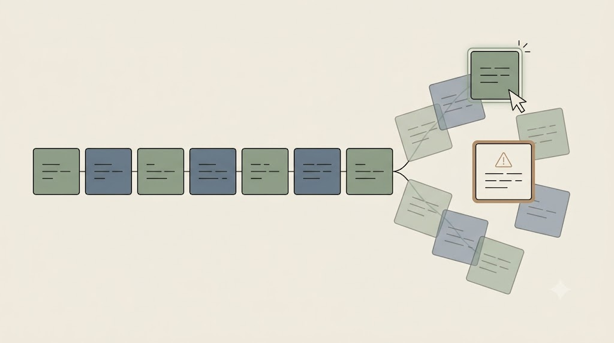
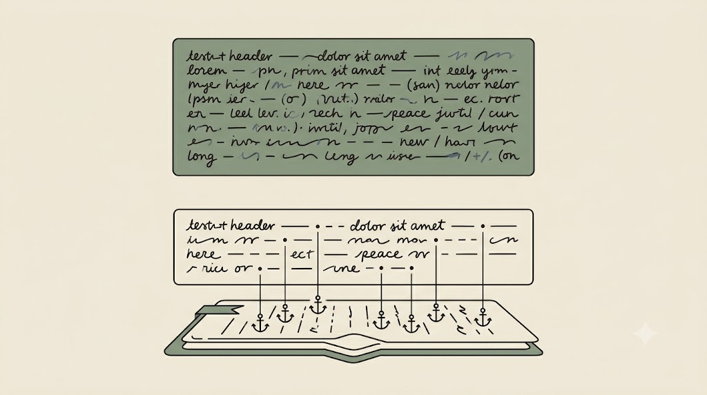

# Halucynacje w 2026 roku i sygnalizator danych

Halucynacja brzmi *dokładnie tak samo pewnie* jak fakt, dlatego potrzebujemy metody jej wykrycia, a nie wyczucia. A skoro dobry prompt zachęca do podawania modelowi coraz więcej materiału, właśnie tutaj zaczyna się ryzyko wycieku danych. Ten rozdział łączy dwie strony tej samej ostrożności: *sprawdź, czy źródło mówi to, co twierdzi model*, i *nadaj danym kolor, zanim je komuś oddasz*.

## Skąd biorą się halucynacje

Zanim nauczymy się je ograniczać, warto zrozumieć mechanizm — bo rozumienie zamienia strach w kontrolę. Model **nie ma wewnętrznej bazy faktów**, którą by sprawdzał. Nauczył się jednej rzeczy: **przewidywać, jaki token (≈ sylaba) najprawdopodobniej pada następny** — to autouzupełnianie doprowadzone do mistrzostwa. Wynikają z tego cztery konsekwencje:

- **Zawsze coś dopowie.** Zadaniem modelu jest *ciągnąć tekst*, nie „wiedzieć". Zmyślony DOI ma poprawny format właśnie dlatego, że model widział tysiące prawdziwych.
- **Płynność to nie wiedza.** Pewny, gładki ton jest cechą dobrego przewidywania *stylu*, a nie *trafności*.
- **Model nie wie, czego nie wie.** Nie ma wewnętrznego „licznika pewności", który zapaliłby się przy zgadywaniu — to *my* sprawdzamy u źródła.
- **Im rzadszy fakt, tym większe ryzyko.** Wąska specjalność to teren, na którym „prawdopodobne" najmocniej rozjeżdża się z „prawdziwym".

Stąd wniosek organizujący cały ten rozdział: halucynacja to nie awaria ani kłamstwo, lecz **normalny efekt uboczny** tego, jak model działa. Nie da się jej wyłączyć — można ją tylko *ograniczać* (zakotwiczeniem) i *wykrywać* (weryfikacją u źródła). Obiema stronami zajmiemy się teraz.

<!-- ════════ GRAFIKA [G31] ════════
TYP: GENERATOR (przewidywanie następnego tokenu)
PLIK: images/g31-mechanizm-halucynacji.png
PROMPT: "Zdanie budowane od lewej z osobnych kafelków-sylab; na prawym końcu kilka półprzezroczystych kafelków-
kandydatów rozgałęzia się jako możliwe następne słowa, z których jeden zostaje wybrany — mechanizm autouzupełniania.
Jeden z kandydatów ma delikatny znak ostrzegawczy (prawdopodobny, lecz nieprawdziwy). Sens: model układa tekst
kafelek po kafelku, wybierając prawdopodobny, nie zweryfikowany. Styl flat, cienka precyzyjna kreska, paleta japandi:
matowe kremowe tło #F1ECE3, akcenty szałwiowa zieleń #8A9A82 i błękit łupkowy #6B7B8C, ciepły akcent ostrzegawczy
#B08A6A, atrament #26211C; bez gradientów i winiet, tekst jako abstrakcyjne kreski (nieczytelny), 16:9." -->

{fig-align="center" width="100%"}

## Co się zmieniło od 2024 roku

Jeszcze niedawno wystarczyło poprosić czat o pięć artykułów z DOI, żeby złapać go na zmyśleniu. Dziś czołowe modele, zwłaszcza z włączonym wyszukiwaniem, częściej podają źródła, które istnieją. Problem nie zniknął, tylko się przesunął: z pytania *„czy ta praca istnieje?"* do pytania *„czy ta praca mówi to, co twierdzi model?"*. Współczesna halucynacja to prawdziwy artykuł z cudzą metodą, poprawna tabela z przesadzonym wnioskiem albo przekonujący most między dwoma pojęciami, którego w literaturze nie ma. Taki błąd przechodzi przez pobieżną kontrolę i dlatego jest groźniejszy.

Skala zjawiska poza salą szkoleniową nie jest marginalna. W artykułach przyjętych na konferencję NeurIPS 2025 znaleziono sto zmyślonych cytowań w pięćdziesięciu jeden pracach, które przeszły recenzję (analiza GPTZero, 2026). Przegląd około 2,5 mln prac z PubMed Central wskazuje wzrost częstości zmyślonych cytowań z jednej na 2828 prac w 2023 r. do jednej na 277 na początku 2026 r. (Topaz i in., *The Lancet*, 2026; metoda bywa krytykowana jako uproszczona). Testy dziesięciu modeli i agentów pokazały, że 3–13% podawanych adresów w ogóle nie istnieje, a agenci *deep research* mylą się tu częściej niż zwykłe czaty z wyszukiwaniem (Rao, Wong i Callison-Burch, 2026).

## Sześć błędów, których szukamy

Zamiast jednej kategorii „halucynacja" pracujemy z mapą sześciu typów. Każdy wygląda inaczej i każdy łapie się na innym etapie weryfikacji.

| # | Typ błędu | Jak wygląda | Kiedy spodziewać się go najbardziej |
|---|---|---|---|
| 1 | **Fałszywy most** | prosisz o prace łączące dwa prawdziwe pojęcia, których nikt nie połączył; model wytwarza tytuły, strony i DOI | pytania „podaj źródła, które…" przy nietypowym zestawieniu |
| 2 | **Błędna atrybucja** | źródło jest prawdziwe, ale metoda, próba, liczba lub teza pochodzą z innej pracy | prace z „bliźniakiem": artykuł i książka, badanie i replikacja |
| 3 | **Konfabulacja niszowa** | szczegóły dopowiedziane „z wzorca gatunku" przy źródłach lokalnych, polskojęzycznych, archiwalnych | rocznik regionalny, uchwała uczelni, monografia lokalna |
| 4 | **Nadinterpretacja danych** | „istotny trend" bez testu, przyczynowość z korelacji, uogólnienie poza próbę, wartości *p* wzięte znikąd | „napisz wyniki do abstraktu", „co z tego wynika?" |
| 5 | **Fałszywa przesłanka** | model przyjmuje błędne założenie pytania i odpowiada „w jego ramach" | „w którym rozdziale X polemizuje z Y?" |
| 6 | **Uległość** (*sycophancy*) | model przytakuje hipotezie badacza albo zmienia poprawną odpowiedź pod presją | dyskusja o własnych wynikach, prośba o „wzmocnienie" wniosku |

Ostatni typ zasługuje na osobne zdanie, bo najtrudniej go zauważyć we własnej pracy. Modele częściej przyznają rację użytkownikowi, niż uzasadniają to dowody, a badacze opisują to zjawisko jako realne zagrożenie dla nauki (Naddaf, *Nature*, 2025; Cheng i in., 2026). Model, który zgadza się z Tobą zbyt chętnie, nie jest recenzentem, tylko echem.

::: {.callout-note title="Przykład: nadinterpretacja w pięciu wierszach danych"}
Poproś model o akapit „Wyniki" do abstraktu na podstawie małej tabeli: pięć grup po osiem pomiarów, średnia aktywność enzymu rośnie od 1,02 do 4,21 U/mg przy dawce 50 mg, a przy 100 mg wynosi 4,30 (SD 0,63–0,71). Typowa odpowiedź zawiera wartości *p*, których nikt nie policzył, „liniową zależność od dawki" (dane wskazują na wypłaszczenie), „dalszy wzrost przy 100 mg" (różnica mieści się w rozrzucie) i zdanie o mechanizmie, którego nikt nie badał. Wszystko brzmi jak fachowy abstrakt.
:::

## Zakotwiczenie wbudowane w prompt

Najprostsza metoda kontroli halucynacji to zakotwiczenie (*grounding*) zapisane wprost w instrukcji:

```text
Odpowiadaj wyłącznie na podstawie poniższego fragmentu.
Każdą tezę poprzyj dokładnym cytatem z fragmentu.
Czego nie ma w materiale — napisz „brak danych". Nie zgaduj, nie wymyślaj źródeł.
```

Różnica jest natychmiastowa. Bez zakotwiczenia, zapytany o coś, czego we fragmencie nie ma (np. „jaka była wielkość próby?" przy fragmencie bez sekcji metod), model **dopowiada prawdopodobną liczbę**. Z zakotwiczeniem odpowiada „brak danych". Nie chodzi o „lepszy" model, lecz o **instrukcję, która zabrania mu wymyślać**.

Wobec subtelnych błędów z mapy powyżej zakotwiczenie warto uzupełnić trzema nawykami:

- **Najpierw pytaj, czy coś istnieje, potem o szczegóły.** „Czy znasz prace łączące X i Y? Jeśli nie masz pewności, napisz to wprost" zamiast „Podaj trzy prace łączące X i Y".
- **Źródło każdej liczby.** „Przy każdej liczbie wskaż, z której komórki danych ją wziąłeś; liczby obliczone oznacz i pokaż obliczenie."
- **Świeży czat jako recenzent.** Wynik oceniasz w nowej rozmowie, bez historii, z rolą krytyka — nie w tej, w której powstał.

<!-- ════════ GRAFIKA [G21] ════════
TYP: GENERATOR (zakotwiczenie odpowiedzi)
PLIK: images/g21-zakotwiczenie.png
PROMPT: "Porównanie dwóch odpowiedzi jedna nad drugą. Górna: pewny, pełny blok tekstu, ale unoszący się
swobodnie, bez korzeni pod spodem (niezakotwiczona halucynacja). Dolna: krótszy blok tekstu z małą kotwicą
opuszczającą cienką linię w dół, do dokumentu źródłowego pod nim, wiążącą każdą tezę z materiałem. Sens:
zakotwiczenie — każda teza przypięta do podanego źródła. Styl flat, cienka precyzyjna kreska, paleta japandi:
matowe kremowe tło #F1ECE3, akcenty szałwiowa zieleń #8A9A82 i błękit łupkowy #6B7B8C, atrament #26211C; bez
gradientów i winiet, tekst jako abstrakcyjne kreski (nieczytelny), 16:9." -->

{fig-align="center" width="100%"}

## Drabina weryfikacji

Zamiast kilku list kontrolnych używamy jednej, pięciostopniowej. Wraca ona przy matrycy literatury, przy NotebookLM i przy raportach *deep research*.

| Szczebel | Pytanie | Gdzie sprawdzasz |
|---|---|---|
| 1. **Istnienie** | czy ta praca lub dokument istnieje? | DOI → [doi.org](https://doi.org); tytuł → Google Scholar, [OpenAlex](https://openalex.org), PubMed; źródła polskie i lokalne → [Biblioteka Nauki](https://bibliotekanauki.pl), [BazHum](https://bazhum.muzhp.pl), [NUKAT](https://katalog.nukat.edu.pl) |
| 2. **Metadane** | czy autorzy, rok, czasopismo, strony się zgadzają? | strona wydawcy, rekord w bazie |
| 3. **Teza** | czy praca twierdzi to, co przypisał jej model? | abstrakt, a przy cytowaniu do tekstu pełny tekst |
| 4. **Metoda i liczby** | czy próba, procedura i wyniki są z *tej* pracy? | sekcja metod i tabele |
| 5. **Status** | czy praca nie została wycofana lub skorygowana i jak przyjęli ją inni? | baner wydawcy, baza Retraction Watch (udostępniana przez Crossref), [Scite](https://scite.ai) |

Próg zależy od stawki, a nie od tego, jak dobrze model wypadł ostatnio. Do orientacji w temacie wystarczą szczeble 1–2 na próbce. Do własnego tekstu każde cytowanie przechodzi szczeble 1–4. Do publikacji — wszystkie pięć.

Akapit z liczbami sprawdzasz dodatkowo **checklistą STAT-5**:

1. Czy **każda liczba** ma źródło w danych albo pokazane obliczenie?
2. Czy słowo „istotny" stoi przy **wykonanym** teście, a nie przy „trendzie"?
3. Czy język przyczynowy („powoduje", „wpływa", „mechanizm") ma oparcie w **projekcie badania**?
4. Czy wniosek **nie wychodzi poza próbę** i warunki pomiaru?
5. Czy podano **wielkość efektu i niepewność**, a nie tylko kierunek?

<!-- ════════ GRAFIKA [G36] ════════
TYP: GENERATOR (drabina weryfikacji)
PLIK: images/g36-drabina-weryfikacji.png
UWAGA: plik jeszcze nie istnieje — po wygenerowaniu wstaw pod tym komentarzem:
{fig-align="center" width="100%"}
PROMPT: "Smukła drabina o pięciu szczeblach oparta o otwartą książkę-źródło. Na każdym szczeblu mała, prosta
ikona: kropka (istnienie), metryczka (metadane), dymek z cytatem (teza), mała tabela (metoda i liczby), znak
ostrzegawczy w okręgu (status: wycofanie). Mała postać badacza wspina się z kartką w dłoni. Sens: im wyższa
stawka, tym wyżej trzeba wejść. Styl flat, cienka precyzyjna kreska, paleta japandi: matowe kremowe tło
#F1ECE3, akcenty szałwiowa zieleń #8A9A82 i błękit łupkowy #6B7B8C, ciepły akcent #B08A6A, atrament #26211C;
bez gradientów i winiet, bez czytelnego tekstu, 16:9." -->

::: {.callout-tip title="Ćwiczenie i artefakt: polowanie na halucynacje"}
W parach wybierz dwie pułapki: jedną ze swojego toru dyscyplinarnego (typy 1–5) i pułapkę uległości (typ 6). Uruchom je w czacie z wyłączonym wyszukiwaniem i sprawdź każdą odpowiedź drabiną weryfikacji. Wypełnij **kartę złapanego błędu**: typ, prompt, co twierdził model, szczebel drabiny, na którym błąd wyszedł, źródło weryfikacji, werdykt i zmianę promptu, która mu zapobiegnie. Model nie popełnił błędu? To też wynik: zapisz test negatywny z dwoma szczeblami weryfikacji i zmień jedną rzecz (wyłącz rozumowanie, zawęź temat, dodaj fałszywą przesłankę). Jeden poprawny wynik niczego nie dowodzi. Artefakt: karta złapanego błędu + checklista weryfikacji (3–5 punktów). Mapa błędów, karta i drabina: `kurs-pe/pulapki/przyklady-halucynacji.md`.
:::

## Sygnalizator danych 🟢🟡🔴

Druga połowa rozdziału dotyczy pytania, które zadajesz *przed* promptem: co w ogóle wolno oddać narzędziu w chmurze. We wcześniejszej wersji szkolenia służyła do tego „klatka prywatności" z pięcioma poziomami wrażliwości i trzema środowiskami. Działała, ale wymagała zbyt wielu decyzji naraz. Zastępuje ją **sygnalizator**: trzy pytania, trzy kolory, trzy decyzje.

```text
1. Czy z tych danych da się rozpoznać konkretną osobę
   (wprost albo z kombinacji cech: wiek + miejscowość + diagnoza)?   TAK → 🔴
2. Czy to nie moje albo obiecałem poufność
   (cudza recenzja, manuskrypt do recenzji, NDA, zgoda uczestników,
   warunki komisji etycznej)?                                          TAK → 🔴
3. Czy to niepublikowane i cenne
   (mój manuskrypt, wniosek grantowy, nowy pomysł, surowe wyniki)?    TAK → 🟡
Wszędzie NIE                                                           → 🟢
```

| Światło | Przykłady z różnych dyscyplin | Gdzie wolno pracować |
|---|---|---|
| 🟢 **Zielone** | opublikowane artykuły, metadane bibliograficzne, publiczne zbiory danych (GUS, Eurostat, GenBank), źródła domeny publicznej, sylabus, własny tekst bez danych osób trzecich | dowolne narzędzie, także konto darmowe — z wyłączonym trenowaniem jako dobrą higieną |
| 🟡 **Żółte** | niepublikowany manuskrypt, wniosek grantowy, dane zagregowane lub spseudonimizowane, kod analizy, notatki zespołu bez nazwisk, niepublikowane wyniki pomiarów | konto z wyłączonym trenowaniem albo czat tymczasowy; narzędzie instytucjonalne; model lokalny — zawsze z minimum danych potrzebnych do zadania |
| 🔴 **Czerwone** | dane osobowe, dane pacjentów, nagrania i transkrypcje przed anonimizacją, dane szczególnych kategorii (RODO art. 9), cudze recenzje i manuskrypty do recenzji, materiały pod NDA | nie do chmury konsumenckiej, także z wyłączonym trenowaniem; model lokalny, narzędzie zatwierdzone przez IOD albo bez AI |

<!-- ════════ GRAFIKA [G04] ════════
TYP: GENERATOR (ilustracja metafory)
PLIK: images/g04-privacy-cage.png
PROMPT: "Subtelna ilustracja: wrażliwe dane badawcze (dokumenty, ikona medyczna, dyktafon) bezpiecznie
wewnątrz delikatnej, świetlistej strefy na laptopie; chmura na zewnątrz oddzielona granicą. Styl flat,
paleta japandi: matowe kremowe tło #F1ECE3, akcenty szałwiowa zieleń #8A9A82 i błękit łupkowy #6B7B8C, atrament #26211C; bez gradientów i winiet, 16:9, bez tekstu." -->

{fig-align="center" width="100%"}

Sygnalizator opiera się na trzech regułach, które warto znać na pamięć:

- **Wyłączenie trenowania nie zmienia czerwonego w żółte.** Przełącznik decyduje o tym, czy rozmowa posłuży do uczenia kolejnych modeli. Nie sprawia, że dane nie opuszczają komputera, ani że nie są przechowywane — dostawcy trzymają rozmowy co najmniej przez okres bezpieczeństwa, zwykle około 30 dni.
- **Czerwone zmienia kolor tylko po prawdziwej anonimizacji.** Zamiana nazwiska na kod (`R-017`) to pseudonimizacja: jest odwracalna, więc dane wciąż są osobowe. Uwaga też na **efekt mozaikowy** — pojedyncze, nieidentyfikujące okruchy (wiek, miejscowość, rzadka diagnoza, styl wypowiedzi) składają się w całość wskazującą jedną osobę, zwłaszcza w małej grupie. W razie wątpliwości kolor zostaje czerwony.
- **Agent na plikach nie oznacza pracy lokalnej.** ChatGPT Work i Claude Cowork działają na folderze na Twoim dysku, ale treść czytanych plików trafia do modelu w chmurze. Folder udostępniony agentowi traktujesz tak samo jak okno czatu: tylko 🟢 i 🟡.

::: {.callout-important title="Recenzje i manuskrypty cudzych autorów"}
To najczęściej lekceważony przypadek czerwonego światła. Polityki wielu wydawców i agencji grantowych wprost zabraniają wgrywania recenzowanych tekstów do narzędzi generatywnych. Zanim użyjesz AI przy recenzji, przeczytaj zasady konkretnego czasopisma lub konkursu.
:::

## Zabezpiecz konto w pięć minut

Ustawienia prywatności są przypisane do **konta**, więc działają tak samo w przeglądarce i w aplikacjach na Windows i macOS. Zmieniasz je raz i sprawdzasz po każdej dużej aktualizacji aplikacji.

| Narzędzie | Wyłącz trenowanie na swoich rozmowach | Rozmowa „bez śladu" |
|---|---|---|
| **ChatGPT** (Chat / Work / Codex) | menu konta → **Ustawienia** → **Kontrola danych** → „Ulepszaj model dla wszystkich" (*Improve the model for everyone*) → wyłącz; na planach indywidualnych obejmuje to także zadania Codex | **czat tymczasowy** — nie trafia do historii ani pamięci |
| **Claude** (czat i Cowork) | menu konta → **Ustawienia** → **Prywatność** → „Pomóż ulepszać Claude" (*Help improve Claude*) → wyłącz | **czat incognito** — nigdy nie służy do trenowania |
| **Gemini** | **Aktywność** → „Zachowuj aktywność" (*Keep Activity*) → wyłącz | **czat tymczasowy** |

W aplikacjach desktopowych menu konta otwierasz kliknięciem w swoje imię lub inicjały w lewym dolnym rogu okna; skrót do ustawień to `Ctrl+,` na Windows i `⌘,` na macOS. W Claude różnica jest wymierna: przy włączonym trenowaniu rozmowy mogą być przechowywane do pięciu lat, przy wyłączonym — standardowo 30 dni. Plany instytucjonalne (ChatGPT Edu, Business i Enterprise; Claude for Work i Enterprise; dostęp przez API) domyślnie nie trenują na danych użytkowników, a retencją zarządza administrator. Plany konsumenckie mają trenowanie włączone domyślnie — wyłączasz je sam.

## Sygnalizator to operacjonalizacja RODO, nie autorska reguła

Wklejenie danych osobowych do modelu w chmurze to **przetwarzanie w rozumieniu RODO** — wymaga podstawy prawnej i podlega zasadzie **minimalizacji** (art. 5: podajesz tylko dane niezbędne do celu). Przy danych osobowych lub medycznych decyzję konsultujesz z **IOD** swojej uczelni. Najczystsza droga zgodności jest zarazem najprostsza: jeśli w prompcie nie ma danych osobowych, nie ma czego regulować.

::: {.callout-warning title="To nie porada prawna"}
Stan prawny się zmienia (m.in. wyrok TSUE z 2025 r. zawężający, kiedy dane *pseudonimizowane* są „danymi osobowymi", oraz pakiet „Digital Omnibus"). Reguła startowa pozostaje ostrożna: **przy wątpliwości traktuj dane jak osobowe** i konsultuj z IOD uczelni. Nazwy pozycji menu w aplikacjach podajemy według stanu na październik 2026 r.
:::

::: {.callout-tip title="Ćwiczenie i artefakt: mój sygnalizator"}
Wypisz pięć typów danych, z którymi realnie pracujesz, i nadaj każdemu kolor przez trzy pytania (`kurs-pe/szablony/sygnalizator-danych-szablon.md`). Przy każdym 🔴 wpisz, co z nim zrobisz: lokalnie, w narzędziu instytucjonalnym albo bez AI. Na koniec wyłącz trenowanie na swoim koncie w ChatGPT lub Claude i zapisz datę sprawdzenia. Artefakt: sygnalizator moich danych — wrócisz do niego w rozdziale o modelach lokalnych.
:::

Mamy już dwa odruchy na całe życie: *sprawdź, czy źródło mówi to, co twierdzi model*, i *nadaj danym kolor*. Dotąd działały w skali pojedynczego promptu. Teraz przenosimy je na skalę całego materiału badawczego — i to jest inżynieria kontekstu.
