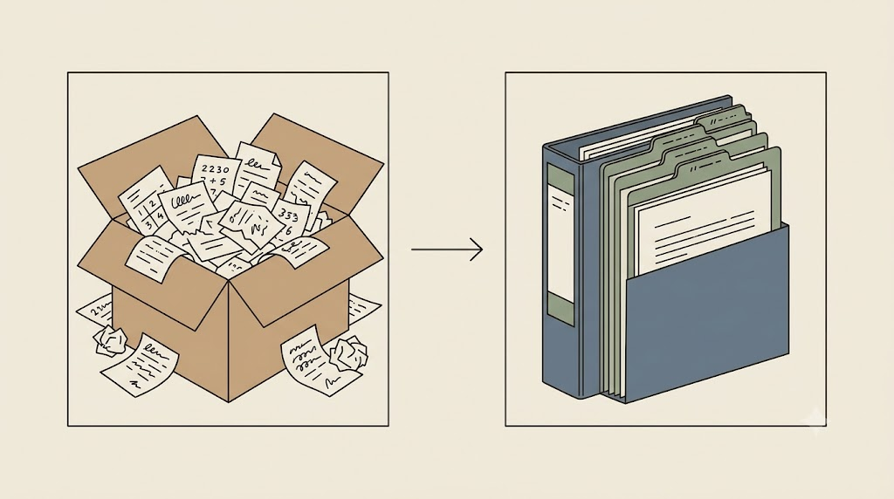
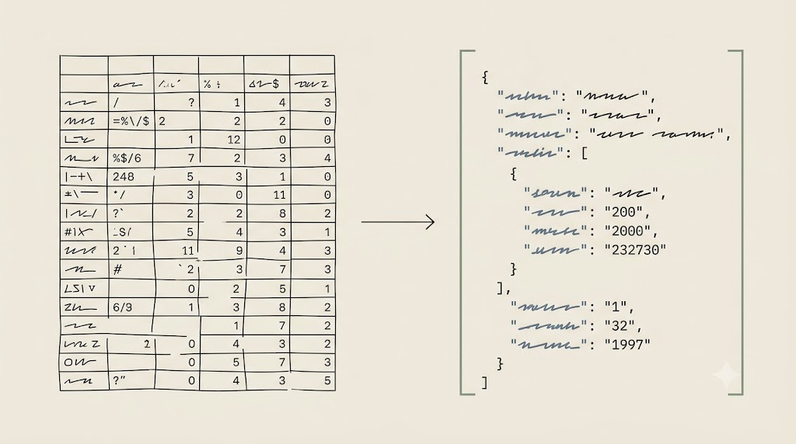

# Dane strukturalne i matryca literatury (RAG)

Czysty Markdown to materiał ciągły. Część informacji badawczych ma jednak **strukturę** — bibliografia, metadane, zakodowane odpowiedzi — i właśnie wtedy sposób ich podania decyduje o wierności wyniku. Ten rozdział łączy dwa kroki na tym samym materiale: zapis danych jako struktura (JSON) oraz zbudowanie z nich „małego RAG" — matrycy literatury.

## Dane strukturalne: JSON zamiast wklejonej tabeli

Wklejona tabela z Excela rozjeżdża się w tekście — model zgaduje, która liczba to rok, a która strona, i myli komórki. Najprościej pomyśleć o tym jak o **fiszce bibliograficznej z etykietami**: zamiast wklejać rozsypany wiersz, zapisujesz każdą informację pod nazwą pola. Dopiero ta fiszka ma techniczną nazwę: **JSON**.

```json
{ "autorzy": ["Kowalski, Jan"], "rok": 2021, "metoda": "analiza jakościowa",
  "glowna_teza": "...", "cytat_kotwica": "...", "strona": 12 }
```

Jeśli nawiasy klamrowe i cudzysłowy wyglądają onieśmielająco, pomocna jest jeszcze jedna, bardziej dosłowna analogia — **karton luźnych kartek kontra segregator z opisanymi teczkami**. Wklejona tabela z Excela to karton, do którego wsypano kartki: po drodze się przetasowały, więc model musi *zgadywać*, która liczba była rokiem, a która stroną. JSON to segregator, w którym każda informacja leży w osobnej teczce z etykietą — *żadna wartość nie może się pomylić, bo każda nosi swój napis*. To nie jest język programowania, którego trzeba się uczyć; to sposób pakowania danych, żeby nie zgubiły opisu.

Do czytania JSON-a wystarczą **trzy znaki** — i to cała „składnia", jaką badacz musi rozpoznać:

| Znak | Po ludzku |
|---|---|
| `{ }` | jedna teczka (rekord — np. jedna pozycja bibliograficzna) |
| `[ ]` | półka z teczkami (lista — np. kilku autorów albo kilka źródeł) |
| `"etykieta": wartość` | napis na teczce i jej zawartość (`"rok": 2021`) |

<!-- ════════ GRAFIKA [G34] ════════
TYP: GENERATOR (analogia: karton luźnych kartek → segregator z teczkami)
PLIK: images/g34-segregator-karton.png
PROMPT: "Dwa panele obok siebie ze strzałką jednokierunkową między nimi. Lewy: otwarty kartonowy pudełko pełne
luźnych, poprzewracanych i pomieszanych karteczek — chaos, rozsypane liczby. Prawy: schludny segregator z
opisanymi, wysuniętymi teczkami-zakładkami, w każdej jedna kartka — porządek, każda teczka ma etykietę.
Minimalistyczna ilustracja edytorska, cienka precyzyjna kreska, płaskie kolory, japandi. Tło matowe kremowe
#F1ECE3. Akcenty szałwiowa zieleń #8A9A82 i błękit łupkowy #6B7B8C; kreska atrament #26211C. Bez gradientów,
winiet i cieni; tekst jako abstrakcyjne kreski (nieczytelny). 16:9." -->

{fig-align="center" width="80%"}

<!-- ════════ GRAFIKA [G11] ════════
TYP: GENERATOR (rozjechana tabela → uporządkowany JSON)
PLIK: images/g11-tabela-json.png
PROMPT: "Dwa panele obok siebie ze strzałką między nimi. Lewy: rozjechana tabela skopiowana z arkusza —
poprzesuwane, pomieszane komórki; niejasne, która liczba to rok, a która strona (chaos). Prawy: uporządkowany
zapis JSON z wyraźnie nazwanymi polami klucz–wartość i schludnymi wcięciami (porządek). Minimalistyczna
ilustracja edytorska, cienka precyzyjna kreska, płaskie kolory, japandi. Tło matowe kremowe #F1ECE3. Akcenty
szałwiowa zieleń #8A9A82 i błękit łupkowy #6B7B8C; kreska atrament #26211C. Bez gradientów, winiet i cieni;
tekst jako abstrakcyjne kreski (nieczytelny). 16:9." -->

{fig-align="center" width="80%"}

JSON ma trzy zalety nad wklejoną tabelą: **nazywa każde pole** (`"rok": 2021` — znika dwuznaczność), jest **stabilny przy zagnieżdżeniu** (np. lista autorów w rekordzie) i — gdy poprosisz o **wynik w JSON** — zwraca dane gotowe do dalszego przetworzenia, choćby wczytania z powrotem do arkusza. (Kiedy wystarczy prostszy CSV, a kiedy warto sięgnąć po JSON — rozstrzygamy niżej, przy konwersji.)

::: {.callout-warning title="Struktura usypia czujność"}
Im czystszy rekord budujesz, tym łatwiej *odruchowo* dołożyć pola identyfikujące (`"nazwisko"`, `"email"`, `"nr_pacjenta"`) — „skoro porządkuję dane, niech będą w komplecie". Tak struktura JSON, która ma pomóc, czyni wyciek najłatwiejszym. Przeciwdziałanie: **klucz zastępczy** (zamiast identyfikatora wstaw `"id": "R-017"`, a mapę trzymaj offline) oraz **minimalizacja pól** — analiza tez nie wymaga nazwisk. Pamiętaj: pseudonimizacja jest odwracalna, więc nie zmienia koloru danych w sygnalizatorze — wciąż są 🔴. Na ćwiczeniach pracujemy wyłącznie na jawnych metadanych bibliograficznych.
:::

::: {.callout-tip title="Ćwiczenie i artefakt"}
Weź 3–5 pozycji z bibliografii (Zotero/Bookends — jawne metadane). Najpierw wklej je jako „brudną" tabelę i poproś o zestawienie; zaobserwuj pomyłki w komórkach. Potem zapisz te same dane w `dane.json` (`kurs-pe/szablony/dane-szablon.json`) jako fiszki z polami *źródło · rok · metoda · teza · luka · cytat-kotwica* i ponów prompt, prosząc o wynik także w JSON. Artefakt: mini-baza literatury w JSON.
:::

### Konwersja tabela → JSON bez programowania

Najczęstsza obawa brzmi: „nie umiem programować, więc nie zapiszę danych w JSON". To nieporozumienie — **konwerterem jest sam model**. Nie instalujesz niczego i nie piszesz kodu; przekazujesz modelowi tabelę wraz z krótkim poleceniem konwersji.

1. **Prompt-konwerter.** Skopiuj tabelę wprost z arkusza lub Worda (`Ctrl+C` / `Cmd+C`) i wklej do czatu razem z instrukcją:

```text
Przekształć poniższą tabelę do formatu JSON. Każdy wiersz zapisz
jako osobny obiekt { }, a nazwy kolumn użyj jako etykiet pól.
Niczego nie dodawaj ani nie poprawiaj — pusta komórka = null.
```

2. **Kontrola odwrotna (krok obowiązkowy).** Zasada ograniczonego zaufania obowiązuje także wobec konwertera: model potrafi pomylić komórki przy przepisywaniu dokładnie tak samo, jak przy wklejonej tabeli. Dlatego po otrzymaniu JSON-a każ go **przekształcić z powrotem w tabelę** i porównaj z oryginałem. Zgodność w obie strony — z tabeli do JSON i z JSON do tabeli — oznacza, że konwersja jest wierna. To ta sama logika, co weryfikacja cytatu u źródła: sprawdzasz nie deklarację, lecz wynik.

3. **CSV czy JSON?** Prosta, płaska lista do jednorazowego odczytu (np. spis nazwisk i lat) wystarczy jako CSV. Po JSON sięgasz, gdy pola są **opisowe**, **zagnieżdżone** (lista autorów w rekordzie) albo gdy wynik ma trafić do dalszego przetworzenia — do arkusza, API czy **agenta**. To ostatnie zastosowanie okaże się kluczowe w rozdziale o agentach: plik `dane-projekt.json`, który zbudujesz tutaj, trafi później do folderu `zrodla/` w katalogu projektu, a agent odczyta go bez zgadywania, bo każde pole nosi etykietę.

::: {.callout-warning title="Konwerter też jest w chmurze"}
Jeśli konwersję wykonujesz w modelu chmurowym, obowiązuje ta sama granica, co przy każdym innym prompcie: do konwertera trafiają **wyłącznie dane jawne lub zagregowane**. Tabelę z danymi respondentów najpierw pseudonimizujesz (klucz zastępczy) albo konwertujesz lokalnie: skryptem Pythona (niżej) lub w **modelu lokalnym** — o tym w rozdziale o lokalnych LLM.
:::

### Konwersja skryptem Pythona: lokalnie, bez chmury

Prompt-konwerter wystarcza przy małych, prostych tabelach. Po skrypt sięgasz w dwóch sytuacjach:

1. **Tabela jest duża albo złożona**: dziesiątki wierszy, scalone komórki, długie teksty z przecinkami i znakami nowej linii. Wklejona do czatbota lub agenta taka tabela często gubi komórki albo przesuwa je między kolumnami, a model przy przepisywaniu potrafi skrócić lub „poprawić” wartość. Skrypt przepisuje każdą komórkę dosłownie.
2. **Dane są wrażliwe (🔴)**: skrypt działa na Twoim komputerze, więc tabela nie trafia do modelu w chmurze. Do LLM wysyłasz dopiero wynik po pseudonimizacji i minimalizacji pól albo nie wysyłasz go wcale.

**Czego potrzebujesz.** Pythona 3 (na macOS i Linuksie zwykle jest zainstalowany) i dwóch bibliotek do plików Office: `pip install openpyxl python-docx`. Polecenie wpisujesz w Terminalu, w folderze z plikiem. Pierwszy argument to plik wejściowy, drugi to plik JSON, który powstanie.

**CSV → JSON**

```bash
python3 -c '
import csv, json, sys
with open(sys.argv[1], encoding="utf-8-sig", newline="") as f:
    first = f.readline(); f.seek(0)
    sep = max(",;\t", key=first.count)
    rows = list(csv.DictReader(f, delimiter=sep))
with open(sys.argv[2], "w", encoding="utf-8") as out:
    json.dump(rows, out, ensure_ascii=False, indent=2)
' dane.csv dane.json
```

Separator (przecinek, średnik albo tabulator) skrypt rozpoznaje z pierwszego wiersza. To ważne, bo polski Excel zapisuje CSV ze średnikami. CSV nie zna typów, więc wszystkie wartości wychodzą jako tekst (`"rok": "2021"`).

**XLSX → JSON**

```bash
python3 -c '
import json, sys, openpyxl
wb = openpyxl.load_workbook(sys.argv[1], data_only=True, read_only=True)
ws = wb[sys.argv[3]] if len(sys.argv) > 3 else wb.active
rows = ws.iter_rows(values_only=True)
header = []
for i, c in enumerate(next(rows), 1):
    name = str(c).strip() if c is not None else f"kolumna_{i}"
    header.append(name if name not in header else f"{name}_{i}")
data = [dict(zip(header, r)) for r in rows if any(v is not None for v in r)]
with open(sys.argv[2], "w", encoding="utf-8") as out:
    json.dump(data, out, ensure_ascii=False, indent=2, default=str)
' dane.xlsx dane.json
```

Skrypt czyta aktywny arkusz. Inny arkusz podajesz jako trzeci argument: `… dane.xlsx dane.json "Arkusz2"`. Zapisuje wartości wyliczone przez formuły, nie same formuły. Liczby zostają liczbami, pusta komórka to `null`, pustych wierszy skrypt nie przepisuje.

**DOCX → JSON (tabele z dokumentu Word)**

```bash
python3 -c '
import json, sys
from docx import Document
tables = []
for table in Document(sys.argv[1]).tables:
    rows = [[c.text.strip() for c in row.cells] for row in table.rows]
    if len(rows) < 2:
        continue
    header = []
    for i, name in enumerate(rows[0], 1):
        name = name or f"kolumna_{i}"
        header.append(name if name not in header else f"{name}_{i}")
    tables.append([dict(zip(header, r)) for r in rows[1:]])
with open(sys.argv[2], "w", encoding="utf-8") as out:
    json.dump(tables, out, ensure_ascii=False, indent=2)
' dane.docx dane.json
```

Wynik to zawsze lista tabel (każda tabela to lista wierszy), także gdy dokument ma jedną tabelę. Pierwszy wiersz tabeli jest nagłówkiem. Tabele z jednym wierszem skrypt pomija.

**Wspólne zabezpieczenia.** Pusty nagłówek dostaje nazwę `kolumna_3`, powtórzony nagłówek dostaje numer (`rok_4`), więc żadna kolumna nie nadpisuje innej. Plik zapisuje się w UTF-8 z polskimi znakami.

**Kontrola wyniku.** Skrypt nie myli komórek, ale nie wie, co jest nagłówkiem. Otwórz JSON i sprawdź liczbę rekordów i nazwy pól. Scalona komórka w Wordzie powtarza tekst w każdej kolumnie, którą obejmuje (pola z końcówką `_2`, `_3`).

**Windows.** Polecenia `python3 -c '…'` działają w Terminalu macOS i Linuksa. W Windows zapisz kod spomiędzy apostrofów jako plik, np. `xlsx2json.py`, i uruchom: `py xlsx2json.py dane.xlsx dane.json`.

## RAG i analiza własnej literatury

„Zapytaj model o literaturę z pamięci" to prosta droga do zmyślonych cytatów. RAG odwraca kolejność.

**RAG po ludzku:** zamiast pytać model z pamięci, **najpierw wyszukujemy właściwe fragmenty z własnych materiałów**, a dopiero potem prosimy o odpowiedź opartą *tylko* na nich. To inżynieria kontekstu w skali biblioteki — albo, jak w metaforze rdzeniowej, egzamin z otwartą książką, ale wyłącznie z *Twoją* książką.

Środowiska, w których to robimy, są lokalne i preferowane: **Obsidian** (notatki i linki), **Zotero** oraz **Bookends** (źródła i cytowania), albo zwykły folder `.md`. DEVONthink pokazuję jako *przykład* zaawansowanego RAG prowadzącego — nie jako wymóg. Notion odpada: przechowuje treść na serwerze, więc nadaje się tylko do danych 🟢.

<!-- ════════ GRAFIKA [G05] ════════
TYP: GENERATOR (diagram RAG)
PLIK: images/g05-rag.png
PROMPT: "Schemat RAG w 3 krokach: (1) biblioteka źródeł → (2) wyszukanie/selekcja trafnych fragmentów
(lupa) → (3) model generuje odpowiedź zakotwiczoną w tych fragmentach. Strzałki, ikony, styl flat,
paleta japandi: matowe kremowe tło #F1ECE3, akcenty szałwiowa zieleń #8A9A82 i błękit łupkowy #6B7B8C, atrament #26211C; bez gradientów i winiet, 16:9, minimum tekstu." -->

{fig-align="center" width="100%"}

### Ta sama zasada w trzech skalach

Zasada „najpierw moje fragmenty, potem odpowiedź" działa na trzech poziomach automatyzacji. Różnią się tym, kto wyszukuje fragmenty — a nie tym, kto odpowiada za wynik.

| Skala | Kto wyszukuje fragmenty | Kiedy wystarcza | Gdzie trafiają dane |
|---|---|---|---|
| **Matryca literatury** | badacz, ręcznie | 3–15 źródeł, pełna kontrola nad każdą komórką | tam, gdzie wkleisz matrycę |
| **Gemini Notebook** (następny rozdział) | narzędzie, w obrębie wgranych źródeł | szybka orientacja w kilkunastu źródłach jawnych | chmura Google — tylko 🟢 |
| **Agent w katalogu projektu** | agent: przegląda pliki, otwiera trafne, cytuje fragmenty z lokalizacją | dziesiątki lub setki źródeł, analizy przekrojowe, zadania powtarzalne | folder lokalny, ale treść czytanych plików idzie do modelu w chmurze (🟢/🟡), chyba że model jest lokalny |

### Matryca literatury: „mały RAG"

W praktyce zaczynamy od **matrycy literatury** — ręcznego, w pełni kontrolowalnego „małego RAG", w którym to badacz decyduje, co wchodzi do kontekstu. Mając choćby kilka wierszy, uruchamiamy prompt zakotwiczony do matrycy:

```text
Na podstawie WYŁĄCZNIE poniższej matrycy:
1) porównaj podejścia metodologiczne; 2) przy każdej tezie wskaż numer wiersza-źródła;
3) nie dodawaj wiedzy spoza tabeli; luki oznacz „brak danych".
```

::: {.callout-important title="Cytaty-kotwice, nie całe PDF-y"}
Do matrycy trafiają **dokładne cytaty z numerem strony**, nie całe dokumenty. Wrzucenie pełnych PDF-ów to klasyczny śmietnik kontekstowy. Groźniejsza jest jednak **konfabulacja komórek**: poproszony, by „pomógł wypełnić" matrycę, model potrafi wygenerować prawdopodobnie brzmiącą tezę, lukę, a nawet *cytat-kotwicę* — z pamięci, nie z Twojego źródła. Jeśli taka komórka wejdzie do matrycy, RAG traci sens. Cytat-kotwica musi być przepisany ze źródła przez badacza albo — gdy pracuje agent — sprawdzony na próbce w pliku źródłowym; rola modelu to **syntezator, nie autor** ustaleń.
:::

### Agentowa analiza literatury w katalogu projektu

Przy pięciu artykułach wystarczy ręczna matryca. Przy pięćdziesięciu ręczna praca staje się wąskim gardłem — i wtedy agent pracujący na folderze czystych plików `.md` robi w kwadrans to, co zajęłoby tydzień. Warunek jest jeden: pracuje według tych samych reguł zakotwiczenia.

**Najpierw PDF → Markdown hurtem.** Skrypt wsadowy z repozytorium materiałów zamienia cały folder PDF-ów na pliki `.md` (🪟 PowerShell: `py konwersja-batch.py -i zrodla\pdf -o zrodla\md` · 🍎 Terminal: `python3 konwersja-batch.py -i zrodla/pdf -o zrodla/md`). Dlaczego Markdown, a nie PDF, gdy pracuje agent? Po pierwsze, **mniej tokenów**: agent czyta treść, a nie stopki i szum układu, więc w tym samym oknie kontekstowym mieści więcej źródeł. Po drugie, **przeszukiwalność**: agent wyszukuje frazy w plikach tekstowych — tak jak Ty funkcją „Znajdź" — i otwiera tylko trafne fragmenty, więc dla większości zadań badawczych nie potrzeba osobnej bazy wektorowej. Po trzecie, **sprawdzalność**: cytat-kotwica wskazuje plik i miejsce w tekście, które otworzysz w każdym edytorze w kilka sekund.

**Potem zadania, których ręcznie się nie robi:**

```text
Przeczytaj CLAUDE.md. Pracuj wyłącznie na plikach z zrodla/md/.

A. Mapa pojęć: wypisz 10 pojęć, które pojawiają się w co najmniej 3 plikach.
   Tabela: pojęcie | pliki | jak definiuje je każdy autor (dosłowny fragment + plik).
B. Kto co twierdzi: zestaw stanowiska wobec tezy „<teza>": popiera / podważa /
   nie zajmuje stanowiska. Przy każdym wpisie dosłowny fragment i nazwa pliku.
C. Sprzeczności: wskaż pary źródeł, które podają sprzeczne wyniki lub definicje.
D. Matryca: dla każdego pliku jeden wiersz „źródło | rok | metoda | teza | luka |
   cytat-kotwica (plik, miejsce)". Zapisz jako wyniki/matryca-robocza.md.

Czego nie ma w plikach, oznacz „brak danych". Nie dopisuj źródeł z pamięci.
Na końcu wypisz pliki, których nie udało się przeczytać lub zrozumieć.
```

**Na końcu kontrola.** Losujesz trzy komórki wyniku i sprawdzasz je protokołem weryfikacji: czy fragment jest w pliku i czy popiera tezę. Raport z pięćdziesięciu plików wygląda na wyczerpujący, nawet gdy agent pominął część z nich — dlatego polecenie każe wypisać pliki nieprzeczytane, a Ty porównujesz liczbę wierszy matrycy z liczbą plików. Agent **skaluje** selekcję i ekstrakcję; werdykt o tym, co trafi do tekstu, zostaje przy Tobie.

### Ten sam wzorzec dla danych empirycznych

Układ „wejście tylko do odczytu, wyniki osobno, plan przed ruchem, ślad pracy" sprawdza się także przy danych.

- **Dane ilościowe.** Agent nie „liczy w głowie": pisze skrypt (R lub Python), uruchamia go na danych z folderu `dane/` i zapisuje skrypt, wynik i opis kroków. Analiza jest **odtwarzalna** — każdy może uruchomić skrypt ponownie i dostać te same liczby. Ty sprawdzasz raport checklistą STAT-5 i porównujesz jedną–dwie wartości z arkuszem.
- **Dane jakościowe.** Agent stosuje **książkę kodów** przygotowaną przez badacza (kod, definicja, przykład, kontrprzykład) i przy każdym zakodowanym fragmencie podaje dosłowny cytat z lokalizacją. Ty kodujesz niezależnie próbkę fragmentów i porównujesz zgodność. Model jest drugim kodującym, nie jedynym; pierwsze badania z lat 2025–2026 opisują taki układ, choć dowody są na razie wstępne. Książkę kodów i interpretację tworzy badacz.

::: {.callout-warning title="Dane empiryczne a sygnalizator"}
Transkrypcje wywiadów i dane osób są zwykle 🔴. Do agenta w chmurze trafiają tylko dane zanonimizowane (nie pseudonimizowane) albo zagregowane; w pozostałych przypadkach ten sam wzorzec uruchamiasz z modelem lokalnym albo pracujesz bez AI. Reguła „skrypt może czytać dane osobowe, kontekst agenta — nigdy" pozwala liczyć lokalnie i przekazywać modelowi tylko zagregowany wynik.
:::

::: {.callout-tip title="Ćwiczenie i artefakt"}
Wypełnij `matryca-literatury.md` (`kurs-pe/szablony/matryca-literatury-szablon.md`) dla 3–5 własnych źródeł: *źródło · rok · metoda · teza · luka · cytat-kotwica (str.)*. Podaj matrycę modelowi i poproś o **przegląd zakotwiczony** z poleceniem „nie wychodź poza tabelę". Przejdź tezę po tezie i sprawdź, czy każda ma numer wiersza-źródła i czy nie pojawiła się wiedza spoza matrycy. Na koniec wybierz **dwie tezy** i dla każdej otwórz oryginał (nie streszczenie): czy cytat-kotwica tam jest i czy popiera tezę? Zapisz werdykt z protokołu weryfikacji (potwierdzone / zniekształcone / niepotwierdzone / sprzeczne). Artefakt: matryca + jeden zakotwiczony akapit przeglądowy z werdyktami dla dwóch tez. Dla chętnych: pierwsza analiza agentowa na własnym folderze `.md` (DC-7) i agent przy danych empirycznych (DC-8).
:::

RAG zaczyna się od ludzkiej selekcji — model syntetyzuje to, co *Ty* uznałeś za istotne, a agent przenosi tę zasadę na setki plików. Zanim jednak oddamy pracę agentowi, zobaczmy narzędzie pośrednie: Gemini Notebook, który część tego procesu automatyzuje w chmurze.
