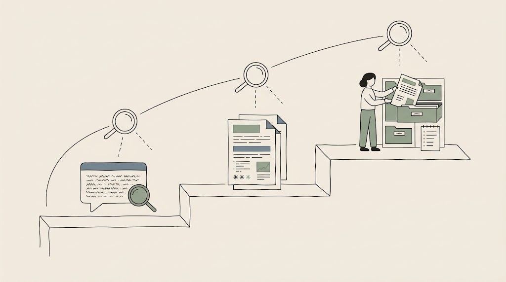
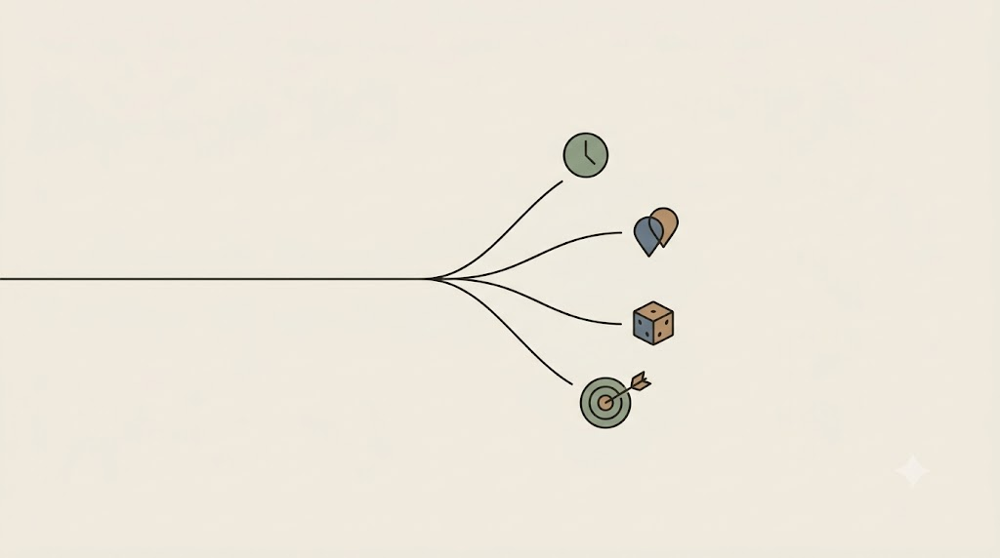
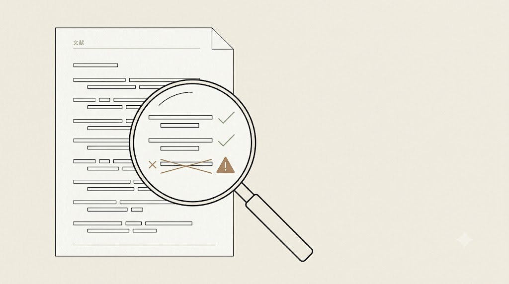

# Wyszukiwanie literatury naukowej wspomagane AI

Przez kilka lat obowiązywały dwie rady: do szukania literatury używaj wyspecjalizowanych aplikacji, a czatu nie pytaj o źródła, bo zmyśla. Obie się zestarzały. Współczesne modele z wyszukiwaniem w sieci i trybem *deep research* znajdują trafne źródła nie gorzej niż narzędzia dedykowane, zwłaszcza poza czasopismami: w książkach, szarej literaturze i źródłach lokalnych. O jakości kwerendy decyduje dziś przede wszystkim **prompt**, czyli protokół wyszukiwania, oraz **weryfikacja** wyników. Ten rozdział pokazuje jedno i drugie, a także trzeci poziom pracy, który dopiero wchodzi do praktyki badaczy: wyszukiwanie agentowe zakończone raportem w pliku.

::: {.callout-note title="Nowa nazwa rozdziału"}
Do października 2026 r. rozdział nosił tytuł „Deep research i jego granice". Granice zostają w treści, ale ciężar przesunął się z oceny jednego trybu na umiejętność prowadzenia kwerendy niezależnie od narzędzia.
:::

## Trzy poziomy wyszukiwania

| Poziom | Co robi | Czas | Kiedy używać | Wynik |
|---|---|---|---|---|
| **Czat z wyszukiwaniem** | kilka zapytań, krótka odpowiedź z odnośnikami | sekundy–minuty | orientacja w temacie, odnalezienie konkretnej pracy | odpowiedź w oknie czatu |
| **Deep research** | model planuje kwerendę, przegląda dziesiątki lub setki stron, składa raport | 5–30 min | stan wiedzy, mapa stanowisk, przygotowanie wstępu | raport z przypisami |
| **Wyszukiwanie agentowe** | agent w aplikacji (Claude z Cowork, ChatGPT Work) lub w terminalu (Claude Code, Codex) wykonuje Twój protokół: odpytuje bazy (OpenAlex, Crossref, PubMed, konektory), sprawdza DOI, usuwa duplikaty, zapisuje wyniki i dziennik zapytań | 10–40 min | kwerenda, którą trzeba udokumentować, powtórzyć lub rozszerzyć | raport `.md`, lista kandydatów w JSON, wpis w logu |

Trzeci poziom jest dla badacza najcenniejszy. Agent nie jest ograniczony do jednej wyszukiwarki ani do schematu przewidzianego przez producenta: łączy bazy, filtruje według Twoich kryteriów i zostawia **ślad metody** — jakie zapytania, kiedy, w jakich bazach, ile trafień, co odrzucono i dlaczego. Raport trafia od razu do katalogu projektu, gdzie może go przeczytać kolejny agent, a pandoc zamieni go w dokument Worda.

## Cztery rodziny modeli

Stan na październik 2026 r.; narzędzia zmieniają się co kilka miesięcy, więc przed zajęciami warto to sprawdzić.

- **ChatGPT** — wyszukiwanie i *deep research* w module Chat, praca na plikach w Work i Codex. W porównaniach praktyków z 2026 r. daje najobszerniejsze raporty akademickie, kosztem czasu oczekiwania.
- **Claude** — wyszukiwanie w sieci i tryb Research, konektory PubMed, Consensus i Scite w aplikacji, praca na plikach w Cowork i Claude Code. Dobrze syntetyzuje długie i sprzeczne materiały; konektory do baz naukowych zmniejszają ryzyko, że zacytuje bloga zamiast pracy recenzowanej.
- **Gemini** — Deep Research zintegrowany z wyszukiwarką Google; raport można przenieść jako źródło do Gemini Notebook.
- **Grok** — DeepSearch: szybka i szeroka kwerenda sieciowa z dostępem do bieżących źródeł i wyraźnym udziałem treści z serwisu X. Dobry do zebrania tropów, słabszy w syntezie akademickiej; bez podanego materiału zdarza mu się zmyślać cytowania.

To nie jest ranking. Porównania z 2026 r. pochodzą głównie z blogów i testów pojedynczych zapytań. Wniosek praktyczny pozostaje stały: **przetestuj dwa modele na własnym pytaniu i sprawdź próbkę źródeł**, zanim któremuś zaufasz.

## Prompt wyszukiwawczy jako protokół

„Znajdź literaturę o wpływie AI na pracę naukowców" daje losową, płytką listę z przewagą blogów. Ten sam model z promptem, który określa pytanie, pojęcia i ich synonimy, zakres, kryteria włączenia, typy źródeł i format raportu, zwraca listę, którą da się sprawdzić, uzupełnić i opisać w sekcji „Metoda". To ta sama struktura czterech warstw, którą znasz z anatomii promptu, rozpisana pod kwerendę:

```text
[ROLA] Jesteś bibliotekarzem dziedzinowym wspierającym przegląd literatury.
Nie podajesz prac, których nie odnalazłeś w trakcie tego wyszukiwania.

[PYTANIE] Jak narzędzia generatywnej AI zmieniają praktyki pisania i recenzowania
w naukach społecznych i medycznych?

[POJĘCIA I SYNONIMY]
- generatywna AI: "large language model", LLM, ChatGPT, "generative AI"
- praca naukowa: "academic writing", "peer review", "scholarly publishing"
Szukaj po angielsku i po polsku.

[ZAKRES I KRYTERIA]
- lata 2023–2026; prace recenzowane, preprinty oznaczone jako preprint,
  raporty instytucji w osobnej sekcji
- WŁĄCZ: badania empiryczne, przeglądy systematyczne
- WYKLUCZ: komentarze bez danych, wpisy blogowe, materiały marketingowe

[FORMAT RAPORTU]
1. Tabela: autorzy | rok | tytuł | czasopismo/wydawca | DOI lub URL | typ pracy |
   jedno zdanie z abstraktu (dosłownie) | dlaczego spełnia kryteria
2. Osobno: prace sprzeczne z dominującym stanowiskiem i prace odrzucone (z powodem).
3. Na końcu: lista użytych zapytań i luki („czego nie udało się znaleźć").

[REGUŁY] Jeśli nie masz pewności, że praca istnieje, nie umieszczaj jej w tabeli.
Nie uzupełniaj brakujących DOI ani stron z pamięci; wpisz „brak".
```

Pięć elementów robi różnicę: **synonimy** (model szuka szerzej niż jedno sformułowanie), **kryteria** (mniej szumu), **dosłowne zdanie z abstraktu** (łatwiej sprawdzić, czy praca mówi to, co jej przypisano), **lista zapytań i odrzuconych prac** (przejrzystość metody) i **zakaz uzupełniania z pamięci** (mniej zmyślonych metadanych). Pytaj o stan wiedzy, nie o potwierdzenie tezy: prośba „znajdź badania potwierdzające, że…" uruchamia uległość modelu i daje stronniczy przegląd. Szablon: `kurs-pe/szablony/prompt-wyszukiwawczy-szablon.md`.

## Wyszukiwanie agentowe z raportem w pliku

Na trzecim poziomie protokół zapisujesz w katalogu projektu (`notatki/protokol-kwerendy.md`) i wydajesz agentowi polecenie:

```text
Przeczytaj CLAUDE.md. Zadanie: kwerenda według protokołu z notatki/protokol-kwerendy.md.
1. Zaplanuj co najmniej 6 zapytań (polskie i angielskie terminy, synonimy).
   Pokaż plan i czekaj na moje OK.
2. Szukaj w: OpenAlex (api.openalex.org), Crossref, PubMed (jeśli temat jest
   biomedyczny) oraz w sieci ogólnej — tylko dla szarej literatury.
3. Dla każdego kandydata zapisz: autorzy, rok, tytuł, źródło, DOI, typ pracy,
   jedno zdanie z abstraktu (dosłownie) i powód włączenia.
4. Sprawdź każdy DOI w Crossref lub na doi.org; bez potwierdzenia oznacz
   „DOI niepotwierdzony". Usuń duplikaty.
5. Zapisz: wyniki/kandydaci.json, wyniki/raport-kwerendy.md (metoda: zapytania,
   daty, bazy, liczba trafień, odrzucone z powodem; potem wyniki i luki)
   oraz wpis w notatki/log.md.
Nie dopisuj prac z pamięci. Nie oceniaj jakości badań — to zrobię ja.
```

Ten sam protokół można spakować w skill `kwerenda-literatury` i wywoływać jednym poleceniem (rozdział o agentach).

::: {.callout-warning title="Dwie granice wyszukiwania agentowego"}
**Bezpieczeństwo.** Agent czyta pobrane strony, więc ich treść trafia do jego kontekstu — każda może zawierać ukryte polecenie (*prompt injection*). Raport zapisujesz do `wyniki/`, nigdy do `zrodla/`, a agent nie działa poza folderem projektu. Zapytania wysyłane przez zdalne konektory widzą ich operatorzy. OpenAlex wymaga od lutego 2026 r. bezpłatnego klucza do API dla zapytań automatycznych; klucza nie trzymaj w folderze udostępnianym agentowi.

**Powtarzalność.** Agent zostawia dziennik zapytań, ale ten sam protokół uruchomiony za tydzień, innym modelem lub z innymi konektorami da nieco inny wynik. Przy przeglądzie systematycznym agent jest więc pomocnikiem (szkic zapytań, deduplikacja, ekstrakcja), a wyszukiwanie właściwe prowadzisz w bazach z udokumentowaną strategią (Scopus, Web of Science, PubMed) zgodnie z wytycznymi PRISMA 2020.
:::

## Narzędzia dedykowane a czat i agent

| Narzędzie | Mocne strony | Ograniczenia |
|---|---|---|
| **Elicit** | wyszukiwanie w indeksie prac naukowych; **ekstrakcja danych z wielu prac do tabeli**; przesiew dla przeglądów systematycznych (w 2026 r. przepływ zgodny z PRISMA 2020); API wywoływane z Claude lub ChatGPT | skuteczność przesiewu raportuje producent; słabsze pokrycie monografii, humanistyki i literatury polskojęzycznej; limity planu darmowego |
| **Consensus** | szybka odpowiedź „co mówi literatura" na pytanie zamknięte; konektor w Claude i ChatGPT | „miernik konsensusu" upraszcza literaturę niejednorodną i nie jest udokumentowanym protokołem wyszukiwania |
| **Research Rabbit** | mapy cytowań: od kilku prac startowych do sieci prac podobnych, cytowanych i cytujących; dobre do eksploracji | nie ocenia jakości prac ani nie tworzy tabel dowodów; od przejęcia przez Litmaps (2025) model freemium z limitami |
| **Czat i deep research** | elastyczność pytania i formatu; dostęp do książek, szarej literatury i źródeł lokalnych; trafność znalezionych źródeł w testach praktyków nie gorsza niż w narzędziach dedykowanych | cytuje też strony popularne; 3–13% podawanych adresów w testach z 2026 r. nie istniało, częściej w deep research; słaba powtarzalność |
| **Agent z konektorami i skills** | Ty definiujesz przepływ: łączysz PubMed, OpenAlex, Scite i własne Zotero; wynik i dziennik w plikach; protokół wielokrotnego użytku | wyższy próg wejścia; koszt zużycia tokenów; ryzyko ukrytych poleceń w pobranych treściach |

Wniosek nie brzmi „narzędzia dedykowane są zbędne". Działają według sztywnego schematu: w nim są szybkie i powtarzalne, poza nim zawodzą, często bez ostrzeżenia. Model ogólny z dobrym promptem albo agent z konektorami jest elastyczny, ale wymaga weryfikacji i opisu metody. Aaron Tay, który porównywał oba podejścia na serii zapytań, zaleca łączyć jedno narzędzie dedykowane z jednym modelem ogólnym, a im mniej dziedzina opiera się na artykułach w czasopismach (humanistyka, prawo, historia), tym większą wagę dawać modelowi ogólnemu (Tay, *The agentic researcher*, 2026).

<!-- ════════ GRAFIKA [G37] ════════
TYP: GENERATOR (trzy poziomy wyszukiwania)
PLIK: images/g37-trzy-poziomy-wyszukiwania.png
PROMPT: "Trzy stopnie schodów od lewej do prawej, na każdym prosty piktogram: dymek czatu z małą lupą (czat z
wyszukiwaniem), złożony wielostronicowy raport z przypisami (deep research), mała postać asystenta przy
szafce z teczkami, który odkłada raport i notes z listą zapytań do opisanej teczki (wyszukiwanie agentowe).
Nad wszystkimi stopniami cienka linia z lupą badacza — weryfikacja na każdym poziomie. Styl flat, cienka
precyzyjna kreska, paleta japandi: matowe kremowe tło #F1ECE3, akcenty szałwiowa zieleń #8A9A82 i błękit łupkowy
#6B7B8C, atrament #26211C; bez gradientów i winiet, bez czytelnego tekstu, 16:9." -->

{fig-align="center" width="100%"}

## Test luki cytowań: który „agent" naprawdę rozumuje

Wiele narzędzi reklamuje się jako *agenci*, co sugeruje, że ułożą plan do dowolnego zadania. W praktyce część z nich to przepływy **zaszyte na sztywno**: model podejmuje decyzje w kilku punktach z góry zaprojektowanej procedury, ale nie potrafi zaprojektować nowej dla zadania spoza schematu. Prosty test (za: Aaron Tay, *Deep Research, Shallow Agency*, 2025) tę różnicę odsłania:

```text
Znajdź artykuł „<tytuł znanego, otwartego artykułu>".
Następnie wskaż prace powiązane tematycznie, które MOGŁY zostać
w nim zacytowane, ale NIE są cytowane.
```

Zadanie wymaga rozłożenia na kroki: znajdź artykuł → wyciągnij bibliografię → znajdź prace pokrewne → odejmij to, co już zacytowane. Narzędzia o sztywnym przepływie zatrzymują się na samym odnalezieniu artykułu albo zwracają prace **już cytowane**. Elastyczne modele częściej wykonują zadanie poprawnie. Wynik dowolnego raportu z kwerendy można ocenić przez cztery typowe tryby porażki:

| Tryb porażki | Jak wygląda w wyniku |
|---|---|
| **Błąd chronologiczny** | sugeruje prace **nowsze** niż artykuł kotwiczny |
| **Nadmiarowość** | podaje prace **już cytowane** |
| **„Przypadkowy sukces"** | trafia w niecytowane prace, choć **w ogóle nie sprawdził** bibliografii |
| **Wynik nietrafny** | zwraca prace **spoza tematu**, byle spełnić warunek „niecytowane" |

<!-- ════════ GRAFIKA [G23] ════════
TYP: GENERATOR (cztery tryby porażki deep research)
PLIK: images/g23-tryby-porazki.png
PROMPT: "Pojedyncze zadanie badawcze wchodzi z lewej jako jedna cienka linia, po czym rozwidla się na cztery
krótkie rozbieżne ścieżki, każda zakończona małym, odrębnym znakiem porażki: zegar (błąd chronologiczny), znak
nakładania/duplikatu (nadmiarowość), kostka/przypadek (przypadkowy sukces), strzała mijająca okrąg (wynik
nietrafny). Styl flat, cienka precyzyjna kreska, paleta japandi: matowe kremowe tło #F1ECE3, akcenty szałwiowa
zieleń #8A9A82 i błękit łupkowy #6B7B8C, ciepły akcent ostrzegawczy #B08A6A, atrament #26211C; bez gradientów
i winiet, 16:9, bez tekstu." -->

{fig-align="center" width="100%"}

## Weryfikacja wyniku kwerendy

Weryfikacja to protokół z rozdziału o halucynacjach zastosowany do raportu. Każdy wiersz tabeli to twierdzenie typu **B** (praca istnieje), a zdanie z abstraktu i powód włączenia to twierdzenia typu **A** (praca mówi to, co jej przypisano). Najgroźniejszy jest werdykt *zniekształcone*: praca istnieje, DOI prowadzi we właściwe miejsce, ale teza się nie zgadza. Taki cytat przechodzi przez pobieżną kontrolę i osadza się w przeglądzie jako „sprawdzony". Do orientacji wystarcza losowa próbka; do tekstu sprawdzasz każdą pracę, którą zacytujesz.

<!-- ════════ GRAFIKA [G14] ════════
TYP: GENERATOR (weryfikacja cytowań)
PLIK: images/g14-deep-research-weryfikacja.png
PROMPT: "Kartka raportu z listą cytowań (jako abstrakcyjne kreski) i lupa najechana na trzy z nich: dwa
oznaczone delikatnym ptaszkiem (zweryfikowane), jeden przekreślony / ze znakiem ostrzeżenia (zmyślony).
Minimalistyczna ilustracja edytorska, cienka precyzyjna kreska, płaskie kolory, japandi. Tło matowe kremowe
#F1ECE3, dużo pustej przestrzeni. Akcenty: szałwiowa zieleń #8A9A82 (ok) oraz ciepły akcent #B08A6A
(ostrzeżenie); kreska atrament #26211C. Bez gradientów, winiet i cieni, bez czytelnego tekstu. 16:9." -->

{fig-align="center" width="100%"}

::: {.callout-tip title="Ćwiczenie i artefakt: kwerenda w dwóch poziomach"}
Wypełnij szablon promptu wyszukiwawczego dla pytania ze swojej pracy: pojęcia z synonimami po polsku i angielsku, zakres, kryteria, format raportu. Uruchom **deep research** na początku (generacja trwa), a w tym czasie zadaj ten sam prompt w **czacie z wyszukiwaniem** innego modelu; osoby z działającym agentem mogą zamiast deep research użyć polecenia agentowego. Z każdego wyniku wylosuj trzy prace i sprawdź twierdzenia B i A, zapisując werdykty w dzienniku weryfikacji. Na koniec w trzech zdaniach porównaj wyniki: udział prac recenzowanych, błędy w metadanych, tryby porażki. Artefakt: prompt wyszukiwawczy, dwa wyniki i dziennik weryfikacji sześciu prac. Dla chętnych: to samo pytanie w Elicit, Consensus i Research Rabbit (DC-9) oraz kwerenda agentowa z raportem w pliku (DC-10).
:::

::: {.callout-warning title="Outsourcing osądu to outsourcing odpowiedzialności"}
Gdy raport z kwerendy trafia — choćby fragmentami — do Twojego przeglądu, to **Ty** firmujesz każdy cytat własnym nazwiskiem. Zmyślone lub przekręcone źródło w recenzji czy publikacji jest *naruszeniem rzetelności naukowej*, nie „błędem narzędzia". Raport to **lista tropów do sprawdzenia**, nie gotowy przegląd; opis kwerendy (narzędzie, data, prompt) i dziennik weryfikacji dołączasz do dokumentacji projektu.
:::

> **Pytanie, które zostaje z Tobą.** Które elementy mojej dotychczasowej kwerendy — bazy, zapytania, kryteria — potrafiłbym opisać w sekcji „Metoda", i co z tego mógłbym zlecić agentowi?

Wyszukiwanie działa w chmurze i na pytaniach jawnych. Co jednak, gdy materiał jest wrażliwy i nie może opuścić komputera? Wtedy schodzimy na poziom modeli lokalnych — i to jest temat następnego rozdziału.
