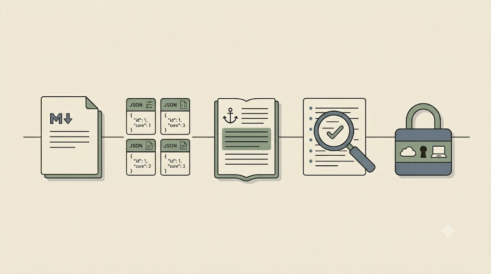

# Integracja, ewaluacja i zamknięcie

Pojedyncze techniki dają wartość dopiero złożone w *powtarzalny, bezpieczny* przepływ, który zostanie z Tobą po szkoleniu. Ten rozdział ma trzy części: najpierw jeden pełny przebieg pracy z agentem na własnym materiale, potem ewaluację, a na końcu nawyk, od którego warto zacząć jutro.

::: {.callout-note title="Co się zmieniło w październiku 2026"}
Wcześniej zamknięcie składało się z kilku luźnych części, a ewaluacja polegała na złożeniu osobnego „portfolio". W praktyce portfolio dublowało katalog projektu z rozdziału o agentach, a jego porządkowanie zabierało czas ostatniego bloku. Dziś dowodem jest sam katalog projektu, budowany przez całe szkolenie, a ewaluacja to krótka lista kontrolna i post-test.
:::

## Własny przepływ z agentem: pięć stacji

Całe szkolenie to jeden ciąg: **prompt → kontekst i dane → nadzorowany agent**. Na koniec przechodzisz go raz od początku do końca, na własnych plikach i we własnym katalogu projektu, korzystając ze skilla tam, gdzie pasuje. Żadna stacja nie jest nową techniką — każda to krok z wcześniejszych rozdziałów:

| Stacja | Co robisz | Decyzja z protokołu |
|---|---|---|
| 1. Źródła | czyste `.md` w `zrodla/`, po kontroli wierności | jaki kolor mają dane? Do folderu agenta tylko 🟢 i 🟡 |
| 2. Ekstrakcja | agent tworzy lub uzupełnia matrycę z cytatami-kotwicami | plan przed ruchem, lokalizacja przy każdym cytacie |
| 3. Synteza | akapit **wyłącznie** z matrycy, z numerem wiersza przy każdej tezie | format + „luki = brak danych" |
| 4. Kontrola | skill `weryfikacja-twierdzen` albo nowa rozmowa w roli recenzenta; Ty zatwierdzasz werdykty | protokół weryfikacji, dziennik |
| 5. Wyjście | pandoc → `.docx`; wpis w `notatki/log.md` | Markdown jako wersja źródłowa |

<!-- ════════ GRAFIKA [G27] ════════
TYP: GENERATOR (pięć stacji przepływu)
PLIK: images/g27-piec-stacji.png
PROMPT: "Pięć małych stacji połączonych od lewej do prawej jedną cienką, ciągłą linią — schludna ścieżka
montażowa; każda stacja to drobny, odrębny piktogram: czysty dokument (czysty markdown), siatka kart z
etykietami (struktura / JSON), zakotwiczony akapit (synteza z kotwicą), lupa z listą kontrolną (kontrola
halucynacji) i mała obudowa/kłódka wybierająca chmurę-lub-laptop (decyzja środowiskowa). Sens: jeden
powtarzalny przepływ złożony z wcześniejszych kroków. Styl flat, cienka precyzyjna kreska, paleta japandi:
matowe kremowe tło #F1ECE3, akcenty szałwiowa zieleń #8A9A82 i błękit łupkowy #6B7B8C, atrament #26211C; bez
gradientów i winiet, 16:9, bez tekstu." -->

{fig-align="center" width="100%"}

Osobisty protokół pracy z AI (`kurs-pe/szablony/PROTOKOL-AI-szablon.md`) łączy na jednej stronie to, czego ten przebieg wymagał: szablon promptu, sygnalizator danych, reguły weryfikacji i zasady doboru narzędzia. Ma *upraszczać* decyzje, nie komplikować.

> **Zasada proporcjonalności.** Prosty prompt do prostego pytania; agent, skills i RAG tylko tam, gdzie złożoność tego wymaga.

::: {.callout-tip title="Ćwiczenie i artefakt"}
Wykonaj jeden pełny przebieg przez pięć stacji na własnym katalogu projektu, a potem poproś drugą osobę o sprawdzenie trzech rzeczy: czy zadanie jest jasno opisane, czy w folderze agenta nie ma danych 🔴, czy wynik ma kotwice i dziennik weryfikacji. Uzupełnij `PROTOKOL-AI.md` i oświadczenie o użyciu AI (`kurs-pe/szablony/ai-disclosure-szablon.md`) z jednym zdaniem o weryfikacji źródeł. Artefakt: przebieg zapisany w katalogu projektu, protokół i oświadczenie.
:::

## Ewaluacja: katalog projektu jako dowód kompetencji

Ocena jest **formująca**, nie rankingowa — chodzi o informację zwrotną i o to, by każdy wyszedł z działającym warsztatem. Ma dwie lekkie części.

**Lista kontrolna katalogu projektu.** Najpierw samoocena, potem wymiana w parach. Każdy punkt odpowiada jednemu efektowi uczenia się, a litery w ostatniej kolumnie to trzy kryteria oceny: **J** — jasność zadania, **O** — ochrona danych, **H** — kontrola halucynacji.

| # | W katalogu projektu jest… | Kryterium |
|---|---|---|
| 1 | `prompty/` z co najmniej sześcioma promptami w stałym formacie i spisem; przy jednym z nich dziennik iteracji v1→v3 | J |
| 2 | notatka o doborze narzędzi, uzupełniona o wnioski z kwerendy | J |
| 3 | **dziennik weryfikacji** z rozdziałów o halucynacjach i wyszukiwaniu | H |
| 4 | **sygnalizator danych** z decyzją dla każdego 🔴 i datą sprawdzenia ustawień kont | O |
| 5 | prompt w wersji Markdown i XML z regułą doboru formatu oraz co najmniej jeden plik danych w JSON | J |
| 6 | `zrodla/` z czystymi plikami `.md` po kontroli wierności | J |
| 7 | brief kontekstowy dla realnego zadania | J |
| 8 | matryca literatury z cytatami-kotwicami i zakotwiczony akapit | H |
| 9 | **`CLAUDE.md` w pięciu sekcjach, `CONTEXT.md`, `WORKFLOW.md`, separacja `zrodla/` i `wyniki/`, log z punktem akceptacji, przetestowany `SKILL.md`** | J·O·H |
| 10 | **`PROTOKOL-AI.md` i oświadczenie o użyciu AI** | J·O·H |

Warunek ukończenia: co najmniej osiem punktów z dziesięciu, w tym obowiązkowo 3, 4, 9 i 10. Punkty niespełnione zapisujesz w `CONTEXT.md` jako „następny krok" — to Twój plan pracy po szkoleniu. Wzór do wydruku: `kurs-pe/szablony/README-portfolio-szablon.md`.

**Post-test.** Krótki test powtarza wybrane pytania z ankiety przed szkoleniem. Służy prowadzącemu do oceny przyrostu i dostrojenia kolejnej edycji, a nie do oceny uczestnika.

## Jeden nawyk na koniec

Zamykamy tym, czym otworzyliśmy: to szkolenie nie jest o tym, żeby „używać wszystkiego", lecz żeby mieć **katalog projektu, protokół i trzy odruchy**. Zacznij od jednego nawyku i rozbudowuj resztę stopniowo.

> Zanim wciśniesz Enter — zapytaj: *„jaki kolor mają te dane, czym to zakotwiczę i jak to sprawdzę?"*

<!-- ════════ GRAFIKA [G08] ════════
TYP: GENERATOR (ilustracja zamykająca)
PLIK: images/g08-zamkniecie.png
PROMPT: "Spokojna, optymistyczna ilustracja: badacz i asystent-AI pracujący ramię w ramię nad
uporządkowanym warsztatem wiedzy (markdown, graf, ikona lokalnego serwera). Symbolika kontroli i
zaufania. Styl flat, paleta japandi: matowe kremowe tło #F1ECE3, akcenty szałwiowa zieleń #8A9A82 i błękit łupkowy #6B7B8C, atrament #26211C; bez gradientów i winiet, 16:9, bez tekstu." -->

{fig-align="center" width="100%"}

## Aneks — źródła i aktualność

Stan narzędzi opisany w tym podręczniku to **październik 2026**. Nazwy modeli i okna kontekstowe zmieniają się w miesiącach, nie latach — sprawdź je u producentów (OpenAI, Anthropic, Google, xAI) i na stronach narzędzi.

- Anthropic — *Effective context engineering for AI agents*; *Steering Claude Code: skills, hooks, subagents and more*; *Extend Claude with skills*.
- Wyszukiwanie literatury — Aaron Tay, *Deep Research, Shallow Agency* (2025) i *The agentic researcher — building custom, transparent and extensible workflows with Claude & MCP* (2026); wytyczne PRISMA 2020 (Page i in., *BMJ*, 2021). Porównania trybów *deep research* i narzędzi dedykowanych z 2026 r. pochodzą głównie z blogów i agregatorów — traktuj je orientacyjnie.
- Weryfikacja i halucynacje — Ji i in., *ACM Computing Surveys* (2023); Huang i in., *ACM TOIS* (2025); Min i in., *FActScore* (EMNLP 2023); Dhuliawala i in., *Chain-of-Verification* (2023); M. Caulfield, S. Wineburg, *Verified* (2023). Halucynacje bibliograficzne — GPTZero, analiza cytowań NeurIPS 2025 (2026); Topaz i in., *The Lancet* (2026); Rao, Wong, Callison-Burch, arXiv:2604.03173 (2026). Uległość modeli — Naddaf, *Nature* (2025); Cheng i in. (2026).
- Skills dla badaczy — I. Shabanov, *Claude Skills for Academics* (2026).
- Praktyka pracy z agentem — E. Beam, E. Aslim, *Thinking With Agents* (2026); Susam Pal, *Three Inverse Laws of AI* (2026).
- Lokalne LLM — Ollama, LM Studio; IBM Granite 4.2 ([ollama.com/library/granite4.2](https://ollama.com/library/granite4.2)); Gemma 4 (Apache 2.0, 2026).
- Konwersja dokumentów — pymupdf4llm, Docling, marker; Pandoc ([pandoc.org](https://pandoc.org/installing.html)).
- Ochrona danych / RODO — decyzja TSUE 2025 ws. danych pseudonimizowanych; wytyczne IOD/DPO uczelni (nie stanowią porady prawnej).
- Ustawienia prywatności i aplikacje (październik 2026) — OpenAI: *Data controls FAQ*, *Moving to the new ChatGPT desktop app*, *ChatGPT Work and Codex*; Anthropic: *Cowork is now Claude* (16.09.2026), *How do I change my model improvement privacy settings*, *How long do you store my data*.

> **Zastrzeżenie.** Liczby i nazwy modeli pochodzą z materiałów branżowych o różnej wiarygodności i szybko się dezaktualizują. Traktuj je jako punkt wyjścia do weryfikacji, nie jako pewnik. Odniesienia prawne nie są poradą prawną — weryfikuj z IOD/DPO uczelni.

Ćwiczenia, które wykraczają poza minimum na sali, zebraliśmy w ostatnim rozdziale: „Dla chętnych".
